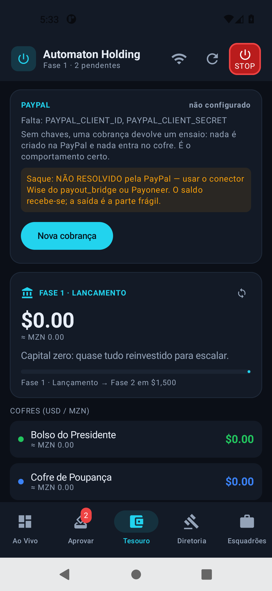
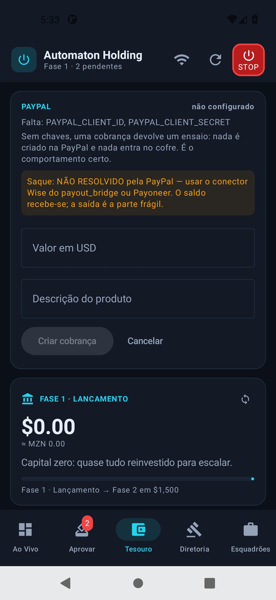

# Pagamentos — o que entra, o que sai, e o que ainda não tem resposta

Última actualização: 2026-11-28.

Documento sem optimismo. A regra é dizer o estado real, incluindo a parte
que ninguém quer escrever: **receber por PayPal funciona; tirar o dinheiro
para um banco moçambicano, não.**

---

## 1. Veredicto curto

| Peça | Estado | Onde |
|---|---|---|
| Receber por PayPal | Implementado, **dry-run** sem chaves | `backend/finance/paypal_cobranca.py` |
| Enviar por PayPal (Payouts) | Implementado, dry-run sem chaves | `backend/finance/payout_bridge.py` (`PayPalConnector`) |
| Receber por M-Pesa / e-Mola | Implementado | `paymentsds-mpesa` (SDK oficial, Apache-2.0) |
| Enviar para M-Pesa / e-Mola | Implementado, exige aprovação biométrica | `payout_bridge` |
| Enviar por Wise | Implementado, exige aprovação biométrica | `payout_bridge` (`WiseConnector`) |
| **Sacar PayPal → banco moçambicano** | **NÃO RESOLVIDO pela PayPal** | ver §4 |
| Tools do Agente CFO | Implementados e testados | `backend/finance/cfo_tools.py` |
| Guardas de dinheiro (MCP incluído) | **A bloquear, testado** | `backend/core/agent_tools.py` |
| Cartão PayPal no APK | **Corrido no emulador, 0 falhas** | `docs/emulador/B10_paypal.png` |

Nada nesta tabela foi confirmado com dinheiro real. Não há credenciais
neste ambiente e não há rede para a PayPal. O que está provado é o
contrato: validação, recusas, dry-run, e quem tem autoridade para quê.

---

## 2. As duas direcções são dois módulos, de propósito

```
dinheiro entra  →  paypal_cobranca.criar_cobranca() → capturar() → cfo.record_revenue()
dinheiro sai    →  cfo_tools.registrar_saques() → aprovação biométrica → payout_bridge.request_payout()
```

Juntá-los num só sítio parecia arrumado e era perigoso: quem recebe e quem
envia têm guardas diferentes. Receber é contabilizar; enviar é autorizar.

---

## 2.1 Como isto se vê no telemóvel



Sem chaves, o cartão diz **«não configurado»** e lista o que falta. O aviso
laranja — «Saque: NÃO RESOLVIDO pela PayPal» — está visível **antes** do
botão de cobrar, não escondido numa secção de ajuda.



Com o campo vazio, «Criar cobrança» está **cinzento**. Uma cobrança de zero
dólares não é uma cobrança, é um engano — e o botão recusa.

Prova: `docs/emulador/RELATORIO_BOTOES_paypal.md` — 0 falhas, passo 9 com
5 verificações OK (run `46170560596`).

---

## 3. «Aprovado» não é «pago»

Esta distinção parece pedante e é a que evita contabilizar dinheiro que
nunca chegou:

- Um pedido PayPal passa por `CREATED` → `APPROVED` → `COMPLETED`.
- Só `COMPLETED` conta como receita (`Cobranca.pago`).
- Um `COMPLETED` em **dry-run** nunca conta: é simulação, não dinheiro.
- Se a PayPal capturar mas não devolver o montante, o registo de receita é
  **recusado com mensagem**, não feito a zero. Um valor errado entra no
  cofre em silêncio e só se descobre no fecho do mês.

---

## 4. O problema que fica escrito

**A PayPal não transfere saldo para bancos moçambicanos.** Receber, recebe-se;
sair é a parte frágil. As alternativas reais:

1. **Payoneer** — recebe USD e permite transferir para conta local; usado
   por freelancers moçambicanos.
2. **Wise** — já tem conector em `payout_bridge` (`WiseConnector`), mas
   exige conta verificada em nome do titular.
3. **Gastar em PayPal** — pagar fornecedores, ferramentas, anúncios. Para
   uma holding que reinveste 70% na fase 1, isto não é um desvio: é a
   divisão a funcionar.

`paypal_cobranca.diagnostico()` devolve este texto no campo
`sacar_para_mocambique`, e a rota `GET /paypal` mostra-o. Quem integrar isto
não descobre o problema em produção.

---

## 5. Os tools do Agente CFO

| Tool | Move dinheiro? | O que faz |
|---|---|---|
| `receber_pagamento` | Não | Regista entrada (PayPal/M-Pesa/e-Mola/Wise/manual) e aplica 5% + divisão por fase |
| `dividir_lucro` | Não | Simula a divisão; não escreve nada |
| `registrar_saques` | **Não** | Cria pedido pendente de biometria e devolve o que falta |

O invariante que importa: **um agente de IA não tira dinheiro da holding.**
`registrar_saques` cria uma aprovação `payout` (crítica) e para aí. A
execução exige `approval_id` aprovado com biometria, montante igual ao
aprovado, e destino igual ao aprovado — guardas que já existiam em
`payout_bridge` e que não foram afrouxadas para caber num tool.

Saque acima do disponível é recusado. O cofre de impostos e o fundo de
reinvestimento não são alcançáveis por um saque, por muito que o agente
insista.

---

## 6. A regra 10/20/70 vive num só ficheiro

`cfo_treasury.PHASES` é a única implementação:

| Fase | Presidente | Poupança | Reinvestimento | Entra em |
|---|---|---|---|---|
| 1 | 10% | 20% | 70% | até $1 500/mês |
| 2 | 10% | 40% | 50% | $1 500 – $15 000/mês |
| 3 | 50% | 30% | 20% | acima de $15 000/mês |

Há um teste (`test_a_divisao_continua_num_so_ficheiro`) que falha se alguém
copiar estas percentagens para `cfo_tools.py`. Duas verdades sobre o mesmo
cofre acabam sempre por discordar, e discordam em silêncio.

---

## 7. Pacotes: o que instalar e o que não tocar

```bash
pip install -r backend/requirements-paypal.txt
```

| Pacote | Versão | Estado (PyPI, 2026-11-28) |
|---|---|---|
| `paypal-server-sdk` | 2.4.0 | Activo — é este |
| `paypal-agent-toolkit` | 1.11.0 | Activo — 42 operações para agentes |
| `paypalrestsdk` | 1.13.3 | **Deprecated** (2023) — não usar |
| `paypal-checkout-serversdk` | 1.0.3 | **Deprecated** (2023) — não usar |

Duas armadilhas que custam uma tarde a cada um:

1. O módulo importa-se como **`paypalserversdk`**, sem underscores.
   `import paypal_server_sdk` dá `ModuleNotFoundError`, e é o que aparece em
   quase todos os exemplos que se encontram.
2. `paypalserversdk.models` não exporta nomes directos — importar dos
   submódulos (`...models.order_request import OrderRequest`).

Os dois pacotes são **opcionais**. Sem eles o backend arranca e o cofre
funciona: `paypal_cobranca` fica em dry-run e `ferramentas_do_agente()`
devolve lista vazia.

---

## 8. Como testar em sandbox

Não há dinheiro real em jogo se seguir estes passos:

1. Criar app em <https://developer.paypal.com/sandbox> e copiar
   `Client ID` / `Secret`.
2. `export PAYPAL_CLIENT_ID=... PAYPAL_CLIENT_SECRET=... PAYPAL_SANDBOX=true`
3. `GET /paypal` → `configurado: true`, `modo: sandbox`.
4. `POST /paypal/cobrancas {"valor_usd": 19.90, "descricao": "..."}` →
   deve devolver `approval_url` e `status: CREATED`.
5. Abrir o `approval_url`, pagar com uma conta sandbox de comprador.
6. `POST /paypal/capturar {"order_id": "..."}` → `status: COMPLETED` e
   `receita_registada` preenchido.

Se o passo 6 devolver `registado: false`, o dinheiro não entrou no cofre —
e é isso que se quer saber, em vez de o descobrir por acidente.

---

## 9. Limites de conteúdo (ToS da PayPal)

A política de uso aceitável da PayPal proíbe conteúdo com direitos de autor
não licenciados. Isto liga-se directamente à regra já existente na holding:
apenas licenças MIT/Apache-2.0/BSD/LGPL, nunca CC-BY-NC. Um produto que
viole a licença não é só um problema legal — é uma conta PayPal congelada
com o saldo dentro.

---

## 10. O que falta, sem rodeios

1. **Saque para Moçambique** — resolvido fora da PayPal (Payoneer/Wise) ou
   não resolvido. Não há código que resolva isto.
2. **14 ferramentas declaradas que não existem** — `GET /agents/tools`
   lista-as por agente. As do CFO estão feitas; as dos outros 16 agentes não.
3. **Nenhuma transacção real** — tudo o que está escrito foi testado em
   dry-run e com testes unitários. A primeira cobrança a sério será a
   primeira vez que o caminho completo corre.
